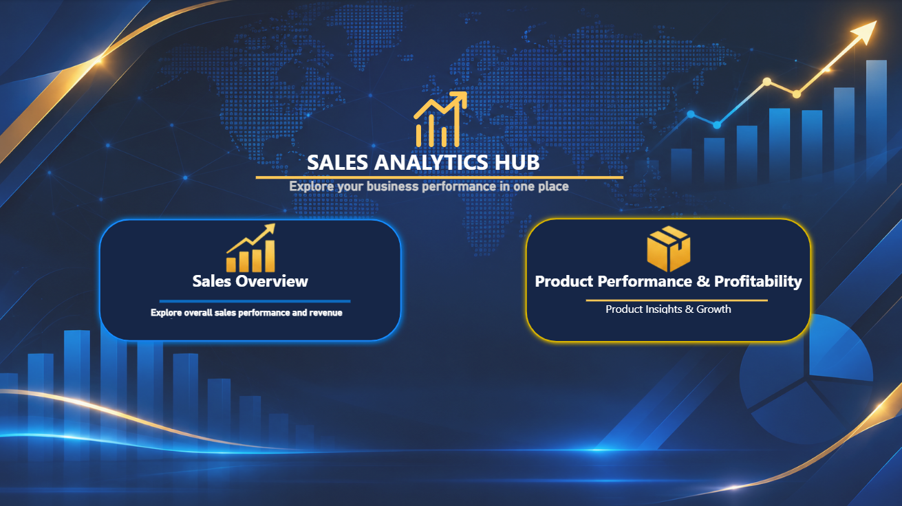
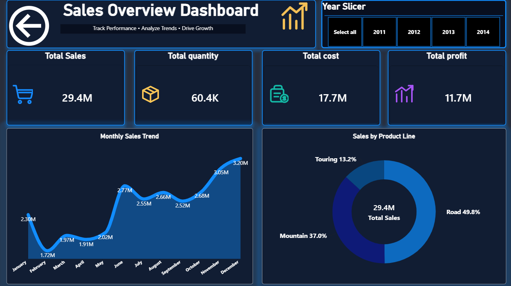
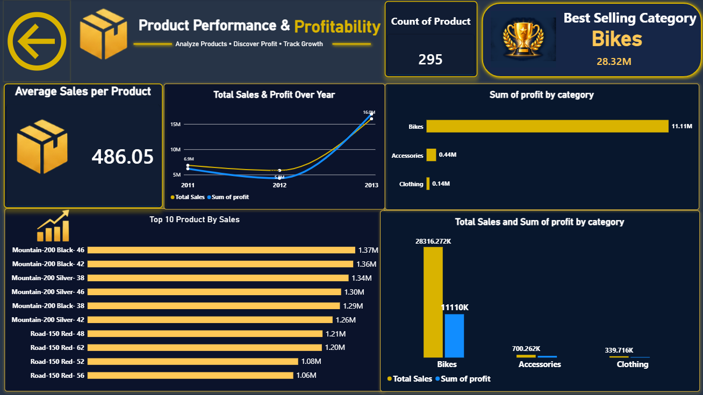

# Sales Performance Analysis

An end-to-end sales analytics portfolio project using **SQL Server, Power BI, and DAX**.

## Project Overview

This project analyzes sales performance, product performance, and business trends using SQL Server and Power BI.

SQL is used to explore the dataset, calculate key business metrics, and perform detailed sales analysis. Power BI is used to transform these insights into interactive dashboards that support data-driven decision-making.

## Tools & Technologies

- SQL Server
- Power BI
- DAX
- Data Analysis & Visualization

## Repository Structure

```text
Sales-Performance-Analysis/
│
├── SQL/
│   └── Sales_Analysis_Corrected.sql
│
├── PowerBI/
│   └── Sales_Dashboard.pbix
│
├── Images/
│   ├── Home.png
│   ├── Sales_Overview.png
│   └── Product_Analysis.png
│
└── README.md
```

## Dashboard Preview

### 1. Home Page

The main navigation page provides access to the different dashboard sections.



### 2. Sales Overview

This page provides an overview of overall sales performance through key performance indicators and interactive visualizations.



### 3. Product Analysis

This page explores product performance, sales distribution, and category-level insights.



## SQL Analysis

The SQL script includes 21 numbered analysis sections covering:

- Data exploration for sales and product tables.
- Daily and yearly sales analysis.
- Total sales, orders, customers, and quantity KPIs.
- Top and bottom products by sales.
- Year-over-year sales comparison using `LAG()`.
- Product sales compared with average sales using window functions.
- Sales and quantity by category and product line.
- Product cost and sales comparisons.
- Products with and without matching sales records.

## Data Model

The project uses the following source tables:

- `dbo.[gold.fact_sales]`
- `dbo.products`

The SQL script assumes the database is named `SalesTrainingDB`.

## How to Use

1. Clone or download this repository.
2. Open the SQL script using SQL Server Management Studio.
3. Connect to a SQL Server instance containing the required database and tables.
4. Execute the SQL analysis sections.
5. Open the Power BI `.pbix` file using Power BI Desktop.
6. Explore the interactive dashboards.

## Project Goals

- Analyze business sales performance.
- Identify top-performing products and categories.
- Compare sales performance across different years.
- Translate raw data into meaningful business insights.
- Build interactive dashboards for business decision-making.

## Author

**Ahmed Gamal**
